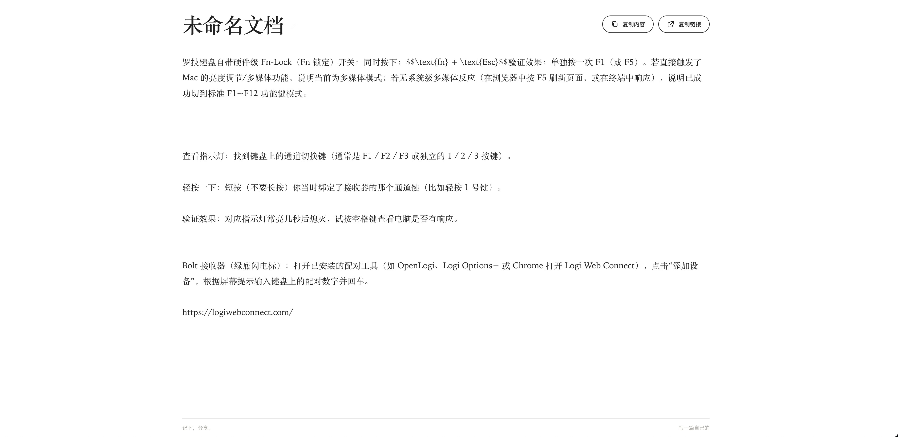
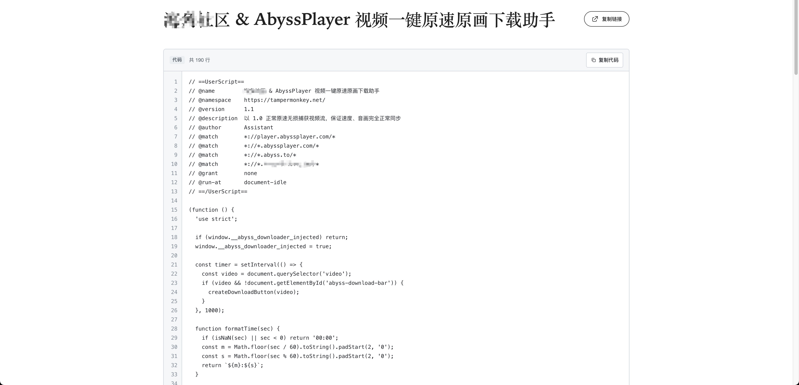

# 在线记事本 (Notepad Online)

[](LICENSE)

轻量、安全、多端自适应的在线记事本服务。支持 Markdown、纯文本及代码三种模式，可方便地在多设备间快速传递文本、代码片段及敏感配置信息。

---

## ✨ 核心特性

- **三种文档模式**：
  - **Markdown 模式**：编辑区保留 Markdown 符号并显示标题字号、语法样式，支持列表续写、丰富工具栏、左右实时预览与自动大纲目录（TOC）。
  - **纯文本 (Text) 模式**：极简清爽，专注轻量文本传递。
  - **代码 (Code) 模式**：自带 GitHub 风格浅色高亮、行号引导栏、Tab 智能缩进及一键复制代码。
- **只读与编辑分离**：
  - `/:id` 默认只读分享，提供一键「复制内容」与「复制链接」。
  - `/:id/edit` 为独立编辑入口，未授权浏览器必须校验文档秘钥。
  - 分享链接支持 `/:id?pwd=2322`：浏览器按文档记住秘钥，点击编辑时自动验证，正确则直接进入编辑；错误时提示手动输入。直接打开 `/:id/edit?pwd=2322` 也会自动验证。
- **完善的安全机制**：
  - **秘钥安全**：采用 bcrypt 哈希单向存储，服务端不存明文；新建时自动生成易记单词秘钥，支持一键随机刷新。
  - **防暴力破解**：单个文档北京时间单日累计输错秘钥 10 次将自动触发当日锁定，次日零点自动恢复。
  - **Cookie 凭据授权**：验证成功后通过 HttpOnly、SameSite 安全 Cookie 维持一年免密编辑。
  - **安全防护**：内置严格安全响应头（X-Frame-Options、HSTS、CSP 等）、请求体大小限制及 IP 级频率限制。
- **HTTP 服务**：
  - 内置服务仅监听 HTTP，默认端口为 `37101`。
  - 如需 HTTPS，可通过 Nginx 等反向代理配置，不再由应用加载 SSL 证书。
- **多端响应式体验**：
  - 移动端自动优化界面排版并隐藏复杂工具栏。
  - 标题长文本智能缩小字号，确保在 PC 端单行水平对齐不折行。

---

## 🖼️ 界面预览

### 1. Markdown 视图
具备左侧大纲目录树、数学公式解析、自适应单行标题以及复制工具栏：


### 2. 纯文本视图
极简清爽的排版，适合设备间快速同步文本与笔记：


### 3. 代码视图
代码模式展示，配备行号引导槽、自适应等宽字体以及独立的「复制代码」功能：


---

## 🚀 快速上手

### 1. 下载可执行文件
前往 [Releases](https://github.com/cute-angelia/notepad-online/releases) 页面下载适合你系统的构建产物。

### 2. 配置 `config.toml`
在可执行文件同级目录下创建 `config.toml`：

```toml
[note]
# 是否开启文件日志
wirteLogFile = false

# 服务监听端口
serverPort = 37101

# 文档路径标识符长度
keyLength = 6

# MySQL 数据库连接串
mysqDsn = "user:password@tcp(127.0.0.1:3306)/notepad?charset=utf8mb4&parseTime=true&loc=Local"
```

### 3. 运行服务

```bash
# 直接启动
./note

# 或通过 PM2 后台守护
pm2 start pm2_nas.json
```

服务启动时会自动检查并执行数据库迁移。

### MinIO 图片与视频附件

Markdown 编辑器支持工具栏选择文件、拖拽文件及粘贴图片。图片默认上限 20 MiB，视频默认上限 5 GiB。文件按 8 MiB 分片顺序上传，Go 流式转发每片，不将整个视频载入内存；失败的分片自动重试，可取消上传。

在 `config.toml` 中添加 `[minio]`，连接字段沿用参考项目的 `minio.nas` 命名：

`endPoint` 只填写主机名及端口，不带 `http://` 或 `https://`；通过 `useSsl` 决定是否使用 HTTPS 连接 MinIO，与记事本服务仅监听 HTTP 无关。

```toml
[minio]
enabled = true
endPoint = "minio.example.com:9000"
accessKeyId = "YOUR_ACCESS_KEY"
secretAccessKey = "YOUR_SECRET_KEY"
useSsl = true
timeout = 120
bucket = "notepad"
prefix = "uploads"
# 可选：公开访问地址，包含 bucket 或对应的 CDN 路径
publicUrl = "https://media.example.com/notepad"
imageMaxSize = 20971520
videoMaxSize = 5368709120
```

对象按北京时间存入 `uploads/YYYY-MM/随机文件名.ext`，例如 `uploads/2026-10/随机文件名.jpg`。不配置 MinIO 或关闭 `enabled` 不影响文本编辑。凭据只在 Go 服务端使用，不下发浏览器，也不要提交实际 `config.toml`。

附件使用永久公开链接，私密笔记也不保护附件 URL。请自行配置已有 bucket 或 CDN 的公开读取权限；服务不会创建 bucket 或修改访问策略。图片插入为 Markdown 图片，视频插入为 `[文件名](地址 "video")`，查看页和实时预览显示播放器。

**编辑过程中移除本系统上传附件的最后一处引用，会立即请求删除 MinIO 文件，不等保存、不延迟、不进回收站。撤销编辑不会恢复文件。** 不做跨文档引用计数，不会删除外部链接指向的文件；删除失败会在附件栏提供重试按钮。上传和删除接口仍需当前文档的编辑授权。

若通过 Nginx 等反向代理部署，将单请求大小设为至少 9 MiB，并为慢速上传留出足够超时；不需要允许单次 5 GiB 请求。例如上传路由可配置 `client_max_body_size 9m`、`proxy_request_buffering off`、`proxy_read_timeout 300s`。中断上传会主动终止分片，但浏览器崩溃或断电无法保证发出取消请求，可在 MinIO 运维端设置未完成分片的过期清理规则。

---

## 🧭 路由规范

| 路径 | 说明 |
| :--- | :--- |
| `/` | 首页：创建新文档（可自选文档类型并自动生成随机秘钥） |
| `/:id` | 公开只读页面：呈现已保存文档内容（支持复制内容与分享链接） |
| `/:id/edit` | 编辑入口：需校验文档秘钥，授权后可实时编辑并自动保存 |
| `/:id/raw` | 纯文本原始内容直出 |
| `/:id/md` | Markdown 纯文本直出 |

---

## 🛡️ 安全与防爆破策略

- **失败锁定规则**：单文档当天（北京时间）累计输错秘钥 10 次，文档将立即进入锁定状态直至次日 00:00，期间禁止任何保存或修改，但只读浏览不受影响。
- **手动应急解锁**：如需立即解除某篇文档的锁定，执行以下 SQL 即可：
  ```sql
  UPDATE notepad SET locked = 0 WHERE tag = '文档ID';
  ```

---

## 🛠️ 本地开发与测试

本项目使用 Go 编写，推荐使用 Go 1.17+ 进行本地构建与测试：

```bash
# 运行全部单元测试（包含鉴权、迁移、中间件及 webserver 多路复用测试）
go test -v ./...

# 静态检查与构建
go vet ./...
go build -o note main.go
```

---

## 📌 致谢与参考

- [Sunbalcony note](https://github.com/Sunbalcony/note)
- [notepad.pw](https://notepad.pw)

---

## 📄 开源许可 (License)

本项目遵循 [GNU General Public License v3.0 (GPLv3)](LICENSE) 开源许可协议。
Copyright (C) 2021-2026 cute-angelia.
